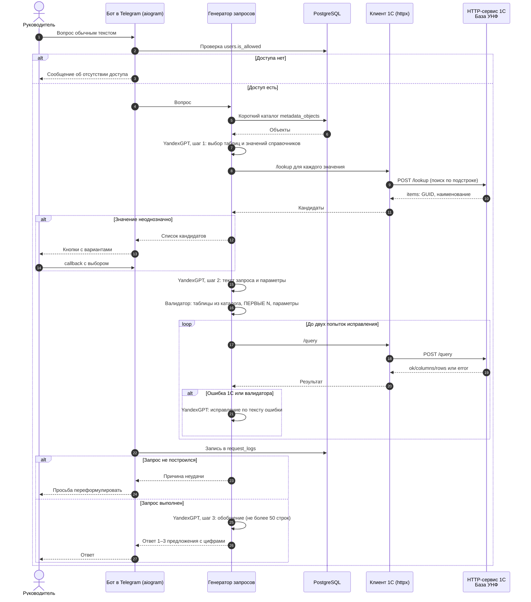

# Подготовка к проекту

Материалы первого спринта: какие данные нужны руководителю, какие способы интеграции с 1С:УНФ рассматривались, как устроен доступ к YandexGPT 5 и как выглядит диалог пользователя с ботом.

## 1. Данные, которые нужны руководителю

Руководитель малого бизнеса задаёт вопросы о состоянии дел, не зная устройства учётной системы. Изучение учебной конфигурации УНФ 3.0.13 показало, что вопросы сводятся к восьми разделам. Полный набор — 31 вопрос с эталонными запросами в `docs/test-questions.md`.

| Раздел | Типовые вопросы |
| --- | --- |
| Продажи | Сколько продали за месяц? Сколько продала конкретная точка? Топ-5 товаров по сумме продаж |
| Закупки | Сколько закупили у поставщика за период? Динамика закупок месяц к месяцу |
| Денежные средства | Сколько денег на расчётных счетах и в кассе? Поступления и расходы за неделю |
| Запасы | Остатки товара на складах на дату? Что заканчивается ниже норматива? |
| Зарплата | Сколько начислили сотрудникам за месяц (ФОТ)? |
| Расчёты с контрагентами | Сколько нам должны покупатели? Сколько мы должны поставщикам? |
| Производство | Сколько выпустили продукции за период? Затраты на производство |
| Доходы и расходы | Финансовый результат за месяц? Структура расходов |

По каждому разделу в тестовом наборе есть четыре типа вопросов: общий показатель за период, показатель с отбором по справочнику (точка, товар, контрагент — название из вопроса ищется по базе), сравнение периодов и рейтинг «топ-N». Значения справочников из вопроса («Партизанская») подставляются в запрос параметром-ссылкой по GUID.

Важная особенность демо-базы: данные лежат за 01.2021–04.2022, поэтому периоды в вопросах берутся из этого диапазона, а «на конец 2021» означает дату 01.01.2022.

## 2. Варианты интеграции с 1С:УНФ

| Способ | Суть | Плюсы | Минусы | Вердикт |
| --- | --- | --- | --- | --- |
| HTTP-сервис в расширении | Свои методы REST, JSON, публикуется на веб-сервере | Лёгкий JSON, полный контроль контракта, работает в расширении без изменения конфигурации, выполняет любой запрос на языке запросов 1С | Публикуется вручную, модуль пишется на встроенном языке | Выбран |
| OData (стандартный интерфейс) | Готовый REST (OData 3.0) поверх объектов конфигурации | Из коробки, публикация штатная | Фиксированная модель сущностей: нет виртуальных таблиц регистров, сложных соединений и группировок; отборы ограничены; позволяет менять данные | Не подходит для произвольных отчётных запросов |
| Веб-сервис (SOAP, XDTO) | Контракт типизированных операций | Строгая типизация | Тяжёлый XML и WSDL, сложнее отладка и версионирование, избыточен для простых запросов | Отклонён |
| COM/внешнее соединение | Прямое подключение через компоненту 1С | Нет публикации на веб-сервере | Привязка к Windows, нужна установка клиентских библиотек 1С на сервере приложения, не масштабируется | Отклонён |
| Файловый обмен / внешняя обработка | Выгрузка по расписанию в файл | Просто | Не интерактивно: ответ с минутами и часами задержки противоречит задаче чат-бота | Отклонён |

Ключевое требование — выполнять произвольные запросы на языке запросов 1С с группировками и виртуальными таблицами регистров, а также строго ограничить доступ только чтением. Это умеет только собственный HTTP-сервис: пользователь сервиса не имеет прав на данные, метод выполняет запрос в привилегированном режиме (язык запросов не меняет данные), а контракт методов `/metadata`, `/lookup`, `/query` фиксируется в `docs/1c-http-service.md`.

## 3. Yandex Cloud и YandexGPT 5

Сервис с 2025 года называется Yandex AI Studio (ранее — Foundation Models), документация — на aistudio.yandex.ru. Актуальное поколение — YandexGPT 5: Lite (февраль 2025), Pro (февраль 2025) и 5.1 Pro (август 2025, доступна бизнес-клиентам через API). Контекстное окно — 32 000 токенов, есть режим рассуждений (reasoning) у Pro.

### Доступ

1. Облако и каталог в консоли Yandex Cloud.
2. Сервисный аккаунт с ролью `ai.languageModels.user`.
3. API-ключ сервисного аккаунта (область действия `yc.ai.foundationModels.execute`) — значение показывается один раз, подходит для фоновой работы. Альтернатива — IAM-токен со сроком жизни 12 часов.
4. Идентификатор каталога (folder id).

Ключ и каталог уже хранятся в `.env` проекта (`YC_API_KEY`, `YC_FOLDER_ID`).

### Способы вызова

Собственный REST API — POST `https://llm.api.cloud.yandex.net/foundationModels/v1/completion`:

```json
{
  "modelUri": "gpt://<folder_id>/yandexgpt-5.1",
  "completionOptions": {"stream": false, "temperature": 0.3, "maxTokens": 2000},
  "messages": [{"role": "system", "text": "..."}, {"role": "user", "text": "..."}]
}
```

Ответ: `result.alternatives[0].message.text`. Есть асинхронный метод `completionAsync` для длинной генерации. Аутентификация: заголовок `Authorization: Api-Key <ключ>` или `Bearer <IAM>`, каталог — в `x-folder-id` (в собственном API достаточно URI модели).

OpenAI-совместимый API — `https://ai.api.cloud.yandex.net/v1/chat/completions`, вызывается штатной библиотекой `openai` с `base_url` и `project=<folder_id>`. Формат `messages` стандартный (`role`/`content`). Поддерживает `response_format: json_schema` — ответ строго по заданной схеме, что снимает проблему разбора JSON от модели в генераторе запросов.

Официальный SDK `yandexcloud` предназначен для управления облачными ресурсами, а не для вызова моделей; для генерации текста в примерах документации используется REST или OpenAI SDK.

### Что учесть в проекте

- Имя модели в URI: `yandexgpt-5.1` (не `yandexgpt/latest` — это устаревший путь на старую Pro 5; документация просит не использовать его в рабочих сервисах).
- Для шагов «выбор таблиц» и «генерация запроса» полезен структурированный вывод по JSON-схеме; для «обобщения ответа» — обычный текст с низкой температурой.
- Запросы к API идут только с сервера бота, ключ в браузере не используется; при желании отключается логирование запросов в облаке (заголовок `x-data-logging-enabled: false`).
- Квоты на число запросов проверяются командой `yc yandex-gpt get-quotas --folder-id <id>`.

## 4. Диаграмма взаимодействия чат-бота



Графические версии этой диаграммы: `docs/diagram-sequence.svg` (векторная, для вставки в отчёт) и `docs/diagram-sequence.png` (растровая). Исходник — `docs/diagram-sequence.mmd`, графика собирается из него через mermaid-cli:

```bash
npx @mermaid-js/mermaid-cli -i docs/diagram-sequence.mmd -o docs/diagram-sequence.svg
npx @mermaid-js/mermaid-cli -i docs/diagram-sequence.mmd -o docs/diagram-sequence.png -s 2
```

Редактируемая версия для draw.io — `docs/diagram-sequence.drawio`. Она получена импортом исходника через «Упорядочить → Вставить → Mermaid» и при повторном импорте актуальна: правьте её в draw.io, а после значительных изменений пересоберите SVG/PNG из обновлённого `.mmd` вручную.

Сценарии, которых нет на главной ветви диаграммы: вопрос не про данные 1С — короткое пояснение с примерами; 1С недоступна — сообщение о недоступности базы; пустой результат запроса — «данных за период нет».
